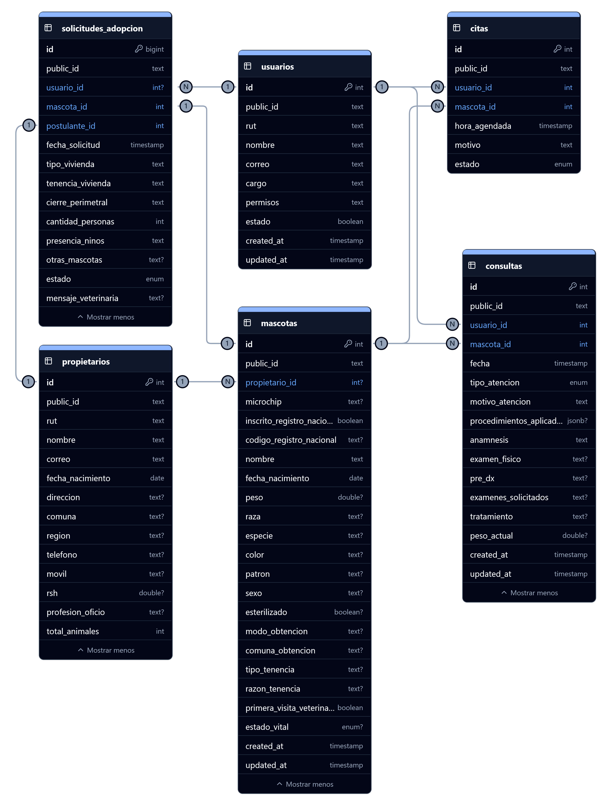

# Accion Mascota

## Descripción
Acción Mascota es una plataforma web de gestión municipal diseñada para centralizar, digitalizar y optimizar los procesos relacionados con la tenencia responsable de animales y los servicios de salud veterinaria pública. El sistema opera como un ecosistema unificado que conecta directamente a los residentes locales con el personal operativo, médico y administrativo de la Unidad de Acción Mascota de la Municipalidad.

La plataforma está estructurada en torno a tres pilares fundamentales:
1. Gestión del Registro Animal y Ficha Clínica: Centralización de la identidad animal (con o sin microchip), vinculando mascotas a sus propietarios (ciudadanos) o categorizándolas como animales comunitarios/rescatados para el seguimiento continuo de su estado de salud, diagnósticos y tratamientos clínicos. El sistema permite gestionar tanto mascotas con propietario identificado como animales comunitarios y rescatados, proporcionando un registro clínico unificado independiente de su condición.

2. Logística Operativa y Atención Municipal: Automatización del agendamiento de citas para la Veterinaria Municipal, optimización de la agenda diaria del personal técnico y provisión de herramientas de reporte de estadísticas mensuales, para el respaldo y presentación de documentos administrativos.

3. Bienestar Animal y Vinculación Comunitaria: Gestión transparente del ciclo de adopciones, que abarca desde la publicación de un catálogo digital de animales rescatados hasta el seguimiento del estado de las solicitudes ingresadas por la comunidad y su evaluación formal.

## Objetivo
Acción Mascota nace con el objetivo de reemplazar procesos manuales y registros dispersos utilizados por la Unidad de Acción Mascota, centralizando en una única plataforma la gestión clínica, administrativa y comunitaria relacionada con la tenencia responsable de animales. El sistema busca mejorar la trazabilidad de la información, optimizar los tiempos de atención y facilitar procesos administrativos mediante la entrega de indicadores y reportes automatizados.

## Características principales

- Registro de propietarios y mascotas.
- Gestión de ficha clínica veterinaria.
- Registro de animales comunitarios y rescatados.
- Agenda de atención veterinaria.
- Solicitudes de adopción.
- Gestión de usuarios municipales.
- Estadísticas y reportes administrativos.
- Dashboard de indicadores.

### Roles
| ROL | Función |
| :--- | :--- |
| Ciudadano | Gestiona sus mascotas, agenda horas y postula a adopciones |
| Usuario Municipal | Registra mascotas, propietarios y administra la operación diaria |
| Veterinario | Registra consultas clínicas y tratamientos |
| Funcionario | Genera reportes e indicadores administrativos |
| Administrador | Administra usuarios y posee acceso completo administrativo al sistema |

### Jerarquía de permisos

```text
Usuario Municipal
├── Veterinario
├── Funcionario
│   └── Administrador

Ciudadano (rol independiente)
```

## Requerimientos Funcionales

### Ciudadano (Propietario)
| ID | Módulo | Descripción |
| :--- | :--- | :--- |
| **RF-CN-01** | Registro de cuenta | El sistema debe permitir a un ciudadano registrarse utilizando su RUT y correo electrónico, verificando previamente la inexistencia de duplicados en la base de datos. |
| **RF-CN-02** | Gestión de mascotas | El ciudadano debe poder agregar una o más mascotas a su perfil (incluso si no cuentan con un microchip inicial) y tener acceso y control sobre este registro. |
| **RF-CN-03** | Historial clínico | El ciudadano debe poder ver el historial médico de sus mascotas, incluyendo citas, consultas y tratamientos, en formato de solo lectura. |
| **RF-CN-04** | Agendamiento de citas | El ciudadano debe poder solicitar horas de atención para los servicios habilitados por la Veterinaria Municipal, cumpliendo con los requisitos estipulados. |
| **RF-CN-05** | Adopción de mascotas | El ciudadano debe poder acceder al catálogo de mascotas disponibles para adopción, enviar un formulario de postulación y hacer seguimiento del estado de su solicitud. |

### Usuario Municipal (Base)
| ID | Módulo | Descripción |
| :--- | :--- | :--- |
| **RF-UM-01** | Registro de usuarios | El usuario debe poder registrar ciudadanos (propietarios) en el sistema. |
| **RF-UM-02** | Registro de mascotas | El usuario debe poder ingresar nuevas mascotas al sistema. Estas pueden o no estar vinculadas a un propietario (ej. animales rescatados o comunitarios). |
| **RF-UM-03** | Gestión de agenda | El usuario debe poder visualizar y gestionar citas médicas. |
| **RF-UM-04** | Actualización ficha animal | El usuario debe poder modificar los datos del registro de una mascota, haciendo énfasis en la actualización del estado vital y el número de microchip. |
| **RF-UM-05** | Gestión de adopciones | El usuario debe poder evaluar las solicitudes de adopción ingresadas por los ciudadanos, cambiando su estado (Aprobada, Rechazada, En Revisión) y emitiendo comentarios de retroalimentación. |
| **RF-UM-06** | Dashboard de indicadores | El usuario debe tener acceso a un panel para visualizar estadísticas globales de la plataforma (ej. total de mascotas registradas, adopciones concretadas, volumen de atenciones). |

### Veterinario (Usuario Municipal)
| ID | Módulo | Descripción |
| :--- | :--- | :--- |
| **RF-VM-01** | Registro atención clínica | El veterinario debe poder generar registros de "Consulta Médica" asociados a una mascota, documentando variables clínicas como anamnesis, tratamiento, peso, diagnósticos, etc. |
| **RF-VM-02** | Herencia operativa | El veterinario cuenta con todos los privilegios de un Usuario Municipal. |

### Funcionario (Usuario Municipal)
| ID | Módulo | Descripción |
| :--- | :--- | :--- |
| **RF-FM-01** | Generar reportes | El sistema debe permitir al funcionario generar y exportar reportes estadísticos mensuales sobre atenciones y métricas operativas para uso administrativo. |
| **RF-FM-02** | Herencia operativa | El funcionario cuenta con todos los privilegios de un Usuario Municipal. |

### Administrador (Jefatura)
| ID | Módulo | Descripción |
| :--- | :--- | :--- |
| **RF-AM-01** | Gestión de personal | El administrador debe contar con privilegios para crear cuentas de acceso a nuevos funcionarios o veterinarios, así como inhabilitarlas cuando cesen sus funciones en la municipalidad. |
| **RF-AM-02** | Herencia operativa | El administrador cuenta con todos los privilegios de un Funcionario/Veterinario, pudiendo intervenir en el agendamiento, registro y gestión de mascotas para apoyar operativamente al equipo. |

## Arquitectura

La plataforma está dividida en cuatro grandes componentes:

- Portal ciudadano.
- Plataforma de gestión municipal.
- Base de datos relacional centralizada.
- Almacenamiento de archivos compatible con S3.

## Diagrama de Datos


## Tecnologías

Frontend
- Next.js
- React
- Tailwind CSS

Backend
- Next.js API
- TypeScript

Base de datos y almacenamiento
- PostgreSQL
- Seaweedfs

Autenticación
- NextAuth
- Keycloak

Infraestructura
- Docker
- Nginx
- Cloudflare Tunnel

## Estado del proyecto

🚧 En desarrollo activo.

Este proyecto se encuentra en desarrollo activo para la Unidad de Acción Mascota de la Municipalidad de Algarrobo. Las funcionalidades, el modelo de datos y la arquitectura pueden evolucionar conforme avancen los requerimientos institucionales.